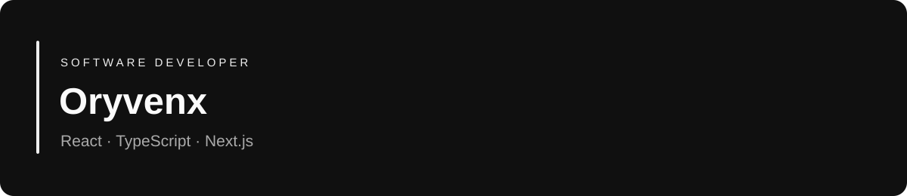

  

**Frontend** · React · TypeScript · JavaScript · Next.js · Tailwind CSS  
**Application development** · PostgreSQL · Supabase · Prisma · Clerk · Better Auth  
**Tools** · Git · Vite · ESLint

### Selected projects

| Project | What it demonstrates | Stack |
| --- | --- | --- |
| [Plany](https://github.com/ArtyomArtenyan/plany-app) · [Demo](https://plany-app-amber.vercel.app/) | Kanban boards, task management, drag and drop, and database persistence | Next.js · TypeScript · Supabase · Clerk |
| [Fitness Rachel](https://github.com/ArtyomArtenyan/fitness-rachel) · [Demo](https://fitness-rachel.vercel.app/) | Reusable page sections, motion, and an image comparison slider | React · TypeScript · Tailwind CSS |
| [Memory Nexus](https://github.com/ArtyomArtenyan/Memory-Nexus) · [Demo](https://memory-nexus-pearl.vercel.app/) | Matching logic, move tracking, and CSS card animations | React · JavaScript · Tailwind CSS |

### In progress

[Omni](https://github.com/ArtyomArtenyan/Omni-second-brain) — a knowledge workspace application. Authentication and workspace management are implemented; document ingestion and AI chat are planned.

### Connect

Explore my work on [GitHub](https://github.com/ArtyomArtenyan). For project-specific questions, please use the relevant repository's Issues tab where available.
